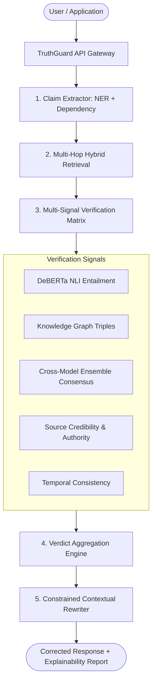

# TruthGuard System Architecture

## 1. High-Level Architecture Overview

TruthGuard is a model-agnostic hallucination detection, verification, and correction system designed as a zero-trust gateway between user applications and Large Language Models.

## 2. Core Subsystems

### 2.1 Claim Extraction & Decomposition Engine
- Segments text respecting domain abbreviations, decimal numbers, and quotation boundaries.
- Splits compound clauses on coordinating conjunctions and action-verb phrases.
- Resolves anaphoric subjects across coordinate sub-clauses.
- Extracts Named Entities and temporal expressions (years, ISO dates, centuries).
- Flags internal logical contradictions across claims in the same output.

### 2.2 Hybrid Evidence Retrieval Engine
- Hybrid dense-semantic (embeddings / cosine similarity) and sparse keyword (BM25 / Jaccard overlap) ranking.
- Multi-hop entity graph traversal for expanded context.
- Temporal validity filters.

### 2.3 Multi-Signal Verification Matrix
- **Natural Language Inference (NLI)**: Calculates entailment, neutral, and contradiction probabilities.
- **Knowledge Graph Validator**: Compares against triples `<Subject, Predicate, Object>` with temporal attributes.
- **Cross-Model Consensus**: Gathers ensemble votes across independent verifier agents.
- **Source Credibility Scorer**: Weights evidence based on authority (.gov, .edu, peer-reviewed), recency, and primary status.

### 2.4 Verdict Aggregation & Domain Gating
- Domain-calibrated thresholds for Healthcare, Legal, Scientific, Education, Journalism, and General profiles.
- Outputs categorical verdicts: `SUPPORTED`, `CONTRADICTED`, `PARTIALLY_SUPPORTED`, `UNVERIFIABLE`, `CONTEXT_INCONSISTENT`, `LOGICALLY_INCONSISTENT`, `TEMPORALLY_INCONSISTENT`, `ENTITY_UNSUPPORTED`.
- Transparent "WHY THIS VERDICT?" explainability synthesis.

### 2.5 Constrained Correction Engine
- Preserves verified and supported spans.
- Replaces contradicted claims with minimal, evidence-grounded facts.
- Explicitly flags unverifiable claims to prevent false authority.
